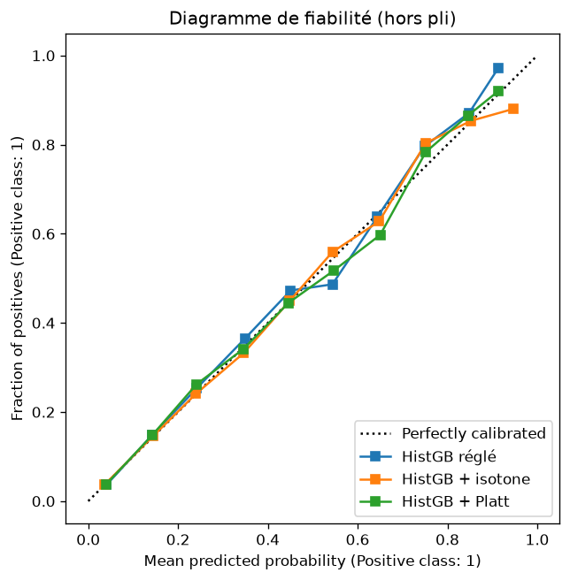
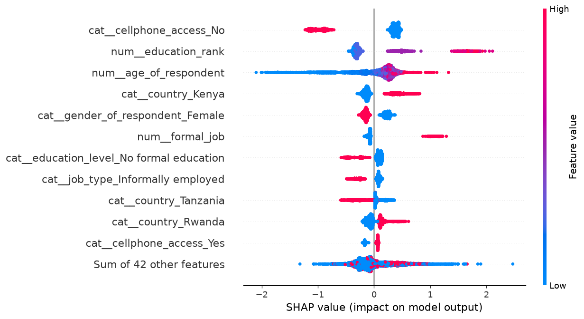

# Qui possède un compte bancaire ? Prédire l'inclusion financière en Afrique de l'Est

Cas pratique du module 5 (AIMS Sénégal) : à partir de 23 524 réponses aux enquêtes FinScope (Kenya, Rwanda, Tanzanie, Ouganda), prédire si une personne possède un compte bancaire.
**Résultat principal** : un HistGradientBoosting réglé avec Optuna puis calibré atteint, sur le test scellé, une **PR-AUC de 0,597 [IC 95 % : 0,560 – 0,634]** (hasard : 0,141). Au seuil choisi selon les coûts (t* = 0,091), il retrouve **88 % des personnes bancarisées** et **divise par deux le coût** de la meilleure stratégie sans modèle.

📄 Rapport final : [reports/rapport_final.md](reports/rapport_final.md)

## Problème

- **Scénario** : KaziPay (entreprise fictive) veut contacter par SMS puis appel les personnes **déjà bancarisées**. Contacter une personne sans compte coûte **0,5 USD** (faux positif) ; oublier une personne bancarisée fait perdre **5 USD** (faux négatif). Une banque centrale veut aussi **compter** les personnes bancarisées par pays en additionnant les probabilités.
- **Classe positive** : `bank_account = "Yes"` (14,08 % des personnes).
- **Métriques** : PR-AUC (principale : classement de la classe rare, indépendant du seuil, référence au hasard = prévalence) ; Brier et ECE (calibration, nécessaire pour le comptage) ; coût métier `0,5·FP + 5·FN` au seuil retenu. L'accuracy est trompeuse : répondre « non » à tout le monde donne 85,9 %.
- **Seuil théorique** : t* = C_FP / (C_FP + C_FN) = 0,5 / 5,5 ≈ 0,091.

## Données

- Source : compétition [Financial Inclusion in Africa](https://zindi.africa/competitions/financial-inclusion-in-africa) (Zindi), enquêtes FinScope 2016–2018.
- 23 524 lignes, 13 colonnes, aucune valeur manquante ; 3 312 personnes bancarisées (14,08 %), de 8,6 % (Ouganda) à 25,1 % (Kenya).
- Pièges repérés (notebook 01) :
  - `year` est entièrement déterminée par `country` (une année par pays) : retirée ;
  - `uniqueid` n'est unique que dans chaque pays (numérotation qui recommence) et n'a pas de sens : retiré ;
  - 7 497 lignes partagent leur profil avec une autre, dont 484 profils à étiquettes contradictoires (1 746 lignes) : bruit irréductible, pas une fuite ;
  - modalités rares (`marital_status = "Dont know"`, 8 lignes ; `education_level = "Other/Dont know/RTA"`, 35) : regroupées par l'encodeur (`min_frequency=20`).
- Les données **ne sont pas versionnées**. Téléchargez sur Zindi (onglet *Data*) le fichier d'entraînement et `VariableDefinitions.csv`, et placez-les dans `data/raw/` en nommant le fichier d'entraînement `inclusion-financiere-en-afrique.csv`.

## Installation

```bash
git clone https://github.com/Diabelll/inclusion-financiere.git
cd inclusion-financiere
uv sync
# puis copier inclusion-financiere-en-afrique.csv dans data/raw/
```

## Reproduction

Exécuter les notebooks **dans l'ordre** (`uv run jupyter lab`) : chacun transmet ses décisions au suivant via `data/processed/decisions.json`.

| Notebook | Étapes | Durée indicative |
|---|---|---|
| `01_exploration.ipynb` | 1–2 · cadrage, exploration | < 1 min |
| `02_preparation_protocole.ipynb` | 3–4 · variables, pipeline, protocole | < 1 min |
| `03_baselines_ensembles.ipynb` | 5–6 · baselines, biais–variance, ensembles | ~8 min (CatBoost) |
| `04_hyperparametres.ipynb` | 7 · Random Search, Optuna, Halving | ~7 min |
| `05_calibration_seuil.ipynb` | 8–9 · calibration, seuil selon les coûts | ~2 min |
| `06_test_final_interpretation.ipynb` | 10–11 · test unique, permutation, SHAP | ~1 min |

Tests : `uv run pytest` · Style : `uv run ruff check src tests`.

## Méthode

- **Code réutilisable** dans `src/inclusion_financiere/` : `config.py` (chemins, graine 42, coûts), `data.py` (chargement, nettoyage, découpage, objet `cv`), `features.py` (`AddFeatures`, préprocesseur, `pipe()`), `evaluate.py` (résumé de CV, ECE, coût, IC bootstrap).
- **Pipeline sans fuite** : `AddFeatures` (règles fixes : rang d'éducation, chef de ménage, emploi formel, urbain × téléphone, tranches d'âge, personne seule, taille du ménage par tranches) → `OneHotEncoder(handle_unknown="infrequent_if_exist", min_frequency=20)` + `StandardScaler` → modèle. Tout ce qui apprend des données est réajusté dans chaque pli.
- **Protocole** : test de 20 % stratifié, mis sous scellé et ouvert une seule fois (notebook 06) ; validation croisée stratifiée à 5 plis (graine 42), **le même objet `cv` pour tous les modèles**, scores toujours donnés en moyenne ± écart-type et comparés pli par pli ; expérience complémentaire « pays jamais vu » avec `StratifiedGroupKFold`.
- **Modèles comparés** : Dummy, régression logistique, forêt aléatoire (régularisée par `min_samples_leaf=50`, règle d'une erreur-type), HistGradientBoosting, XGBoost, LightGBM, CatBoost (catégories natives).
- **Réglage** : HistGB, 40 essais Random Search et 40 essais Optuna (TPE), PR-AUC, mêmes plis.
- **Calibration** : Platt et isotone via `CalibratedClassifierCV(cv=5)`, mesurées sur des prédictions hors pli (Brier, ECE, diagramme de fiabilité).
- **Seuil** : t* théorique, confirmé par `TunedThresholdClassifierCV` et la courbe de coût hors pli.

## Résultats

### Validation croisée (train, 5 plis, PR-AUC moyenne ± écart-type)

| Modèle | PR-AUC | ROC-AUC | Brier | Temps fit |
|---|---|---|---|---|
| Dummy | 0,141 ± 0,000 | 0,500 | 0,141 | 0,3 s |
| Régression logistique | 0,559 ± 0,028 | 0,849 | 0,087 | 0,5 s |
| Random Forest (leaf=50) | 0,566 ± 0,032 | 0,854 | 0,088 | 1,8 s |
| XGBoost (défaut) | 0,544 ± 0,024 | 0,845 | 0,090 | 1,0 s |
| LightGBM (défaut) | 0,565 ± 0,028 | 0,855 | 0,086 | 0,6 s |
| HistGB (défaut) | 0,568 ± 0,028 | 0,857 | 0,086 | 1,0 s |
| CatBoost natif (défaut) | 0,582 ± 0,027 | 0,863 | 0,084 | 62 s |
| **HistGB réglé (Optuna)** | **0,579 ± 0,026** | 0,861 | 0,085 | ~1 s |

CatBoost gagne tous les plis mais de peu (~0,015) et il est 60 fois plus lent ; HistGB a été retenu pour sa rapidité. Le réglage apporte +0,011 (0,4 écart-type), un gain modeste et optimiste (maximum de 40 essais).

### Test (4 705 personnes, ouvert une seule fois)

| Métrique | Valeur |
|---|---|
| PR-AUC | **0,597** [0,560 – 0,634] |
| ROC-AUC | 0,875 [0,861 – 0,889] |
| Brier / ECE | 0,082 / 0,012 |
| Matrice (TN, FP, FN, TP) au seuil 0,091 | 2 770 ; 1 273 ; 80 ; 582 |
| Recall / précision | 0,879 / 0,314 |
| **Coût au seuil retenu** | **1 036,5 USD** |
| Coût au seuil 0,5 | 2 109,0 USD |
| Contacter tout le monde / personne | 2 021,5 / 3 310,0 USD |

L'estimation de validation croisée (0,577) tombe dans l'intervalle de confiance du test.

> **Remarque sur le test (Q10.3).** Dans mes premiers brouillons (non publiés), j'avais calculé par erreur quelques scores sur le jeu de test dès l'étape 3 (ROC-AUC d'une régression logistique et d'une forêt aléatoire, autour de 0,86–0,87). Je m'en suis rendu compte et j'ai tout refait avec le test sous scellé. Aucun choix final (modèle, hyperparamètres, calibration, seuil) n'a été fait à partir de ces scores, mais le test n'était pas « vierge » à 100 % : les résultats sur le test sont donc peut-être un peu optimistes.

## Figures

| | |
|---|---|
|  |  |
|  |  |

Les variables les plus importantes (permutation et SHAP) sont l'**éducation**, le **type d'emploi**, le **pays**, l'**accès au téléphone** et l'**âge**.

## Limites

- **Généralisation à un autre pays** : en laissant un pays entier de côté, la ROC-AUC baisse (0,79 à 0,84). Les quatre pays sont d'Afrique de l'Est (2016–2018) : un usage au Sénégal demanderait des données locales, une nouvelle évaluation et une recalibration.
- **Variables sensibles** : le genre contribue aux prédictions et le recall est plus faible chez les femmes (0,85 contre 0,91). Je recommande de le retirer des variables de décision et de le garder pour auditer l'équité (voir Q11.4).
- **Coûts hypothétiques** : 0,5 et 5 USD sont des hypothèses pédagogiques ; le seuil doit être recalculé avec les vrais coûts (t* = 0,20 si C_FN = 2 USD).
- **Corrélation, pas causalité** : le modèle ne dit pas que donner un téléphone ou une formation ferait ouvrir un compte.
- **Comptage par pays** : pour la banque centrale, la régression logistique donne des sommes de probabilités plus justes (erreur moyenne 0,2 %) que HistGB (2,5 %).
- Une seule graine, un seul découpage ; les comparaisons de méthodes de recherche (Random Search vs Optuna) ne se généralisent pas.

## Réponses aux questions de l'étape 0

**Q0.1** — `uv.lock` enregistre les **versions exactes** (et les empreintes) de toutes les dépendances, directes et indirectes : `uv sync` recrée le même environnement sur n'importe quelle machine. Il est petit, textuel et indépendant du système : il se versionne. `.venv/` est l'environnement installé : lourd, propre à un système d'exploitation et à un chemin, et entièrement **reconstructible** à partir de `uv.lock`. Le versionner serait inutile et fragile.

**Q0.2** — (1) **Conditions d'utilisation** : les données appartiennent à Zindi / FinScope ; les redistribuer sur un dépôt public n'est pas autorisé, chacun doit les télécharger à la source. (2) **Taille et nature** : Git est fait pour du code ; des fichiers de données lourds alourdissent l'historique pour toujours. (Plus généralement, des données personnelles ne doivent jamais se retrouver dans un dépôt public.)

**Q0.3** — Une seule version de chaque fonction : une correction s'applique partout et les notebooks restent cohérents entre eux (même découpage, même `cv`, même pipeline) ; le code est **testable** (`tests/`) et importable (`from inclusion_financiere.features import pipe`) ; les notebooks restent courts et centrés sur l'analyse.
