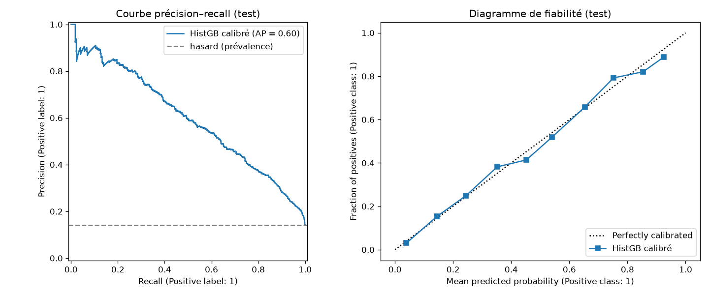
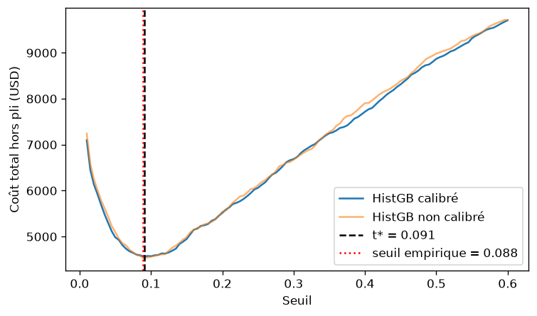

# Qui possède un compte bancaire ? Prédire l'inclusion financière en Afrique de l'Est

Cas pratique du module 5 (AIMS Sénégal). Avec 23 524 réponses aux enquêtes FinScope (Kenya, Rwanda, Tanzanie, Ouganda), on essaie de prédire si une personne a un compte bancaire.

Résultat principal : mon modèle final (HistGradientBoosting réglé avec Optuna, puis calibré) obtient une PR-AUC de 0,597 sur le test [IC 95 % : 0,560 – 0,634], alors qu'au hasard on aurait 0,141. Avec le seuil choisi selon les coûts (0,091), il retrouve 88 % des personnes qui ont un compte et coûte deux fois moins cher que de contacter tout le monde.

📄 Rapport final : [reports/rapport_final.md](reports/rapport_final.md)

## Problème

- L'entreprise KaziPay (fictive) veut contacter les personnes qui ont déjà un compte. Contacter quelqu'un sans compte coûte 0,5 USD. Oublier quelqu'un qui a un compte coûte 5 USD. Une banque centrale veut aussi compter les personnes bancarisées dans chaque pays.
- On cherche les `bank_account = "Yes"` : seulement 14 % des personnes.
- Métriques :
  - PR-AUC (principale) : elle regarde si le modèle trouve bien les « Yes », qui sont rares ;
  - Brier et ECE : pour vérifier que les probabilités sont justes (utile pour compter) ;
  - coût en dollars : `0,5·FP + 5·FN`.
- Je n'utilise pas l'accuracy : un modèle qui répond « non » à tout le monde a déjà 85,9 %.
- Seuil : comme un oubli coûte 10 fois plus qu'un contact inutile, le seuil est 0,5 / (0,5 + 5) ≈ 0,091 et pas 0,5.

## Données

- Source : la compétition [Financial Inclusion in Africa](https://zindi.africa/competitions/financial-inclusion-in-africa) sur Zindi (enquêtes 2016–2018).
- 23 524 lignes, 13 colonnes, aucune valeur manquante. 14,08 % de personnes bancarisées : de 8,6 % en Ouganda à 25,1 % au Kenya.
- Ce que j'ai remarqué (notebook 01) :
  - `year` donne la même information que `country` (une seule année par pays), je l'ai retirée ;
  - `uniqueid` est juste un numéro qui recommence dans chaque pays, je l'ai retiré ;
  - 484 profils identiques ont des réponses différentes : aucun modèle ne peut être parfait ;
  - quelques modalités sont très rares, l'encodeur les regroupe (`min_frequency=20`).
- Les données ne sont pas dans le dépôt. Il faut les télécharger sur Zindi (onglet *Data*) avec `VariableDefinitions.csv`, et les mettre dans `data/raw/` en appelant le fichier d'entraînement `inclusion-financiere-en-afrique.csv`.

## Installation

```bash
git clone https://github.com/Diabelll/inclusion-financiere.git
cd inclusion-financiere
uv sync
# puis copier inclusion-financiere-en-afrique.csv dans data/raw/
```

## Reproduction

Il faut lancer les notebooks dans l'ordre (`uv run jupyter lab`), car chacun passe ses choix au suivant via `data/processed/decisions.json`.

| Notebook | Étapes | Durée indicative |
|---|---|---|
| `01_exploration.ipynb` | 1–2 · cadrage, exploration | < 1 min |
| `02_preparation_protocole.ipynb` | 3–4 · variables, pipeline, protocole | < 1 min |
| `03_baselines_ensembles.ipynb` | 5–6 · baselines, biais–variance, ensembles | ~8 min (CatBoost) |
| `04_hyperparametres.ipynb` | 7 · Random Search, Optuna, Halving | ~7 min |
| `05_calibration_seuil.ipynb` | 8–9 · calibration, seuil selon les coûts | ~2 min |
| `06_test_final_interpretation.ipynb` | 10–11 · test unique, permutation, SHAP | ~1 min |

Tests : `uv run pytest` · Style : `uv run ruff check src tests`.

## Méthode

- Le code réutilisable est dans `src/inclusion_financiere/` : `config.py` (chemins, graine 42, coûts), `data.py` (chargement, nettoyage, découpage, `cv`), `features.py` (nouvelles variables, pipeline), `evaluate.py` (scores, coût, intervalles de confiance).
- Tout est dans un pipeline (nouvelles variables → one-hot + standardisation → modèle), pour éviter les fuites : tout est réappris dans chaque pli.
- J'ai mis 20 % des données de côté pour le test, ouvert une seule fois à la fin (notebook 06).
- Les modèles sont comparés avec une validation croisée stratifiée à 5 plis, toujours les mêmes plis, en donnant moyenne ± écart-type. J'ai aussi testé le cas « pays jamais vu ».
- Modèles comparés : Dummy, régression logistique, forêt aléatoire, HistGradientBoosting, XGBoost, LightGBM, CatBoost.
- Réglage de HistGB : 40 essais Random Search et 40 essais Optuna.
- Calibration : Platt et isotone, vérifiées sur des prédictions hors pli.
- Seuil : le seuil théorique, vérifié avec `TunedThresholdClassifierCV`.

## Résultats

### Validation croisée (train, 5 plis, PR-AUC moyenne ± écart-type)

| Modèle | PR-AUC | ROC-AUC | Brier | Temps fit |
|---|---|---|---|---|
| Dummy | 0,141 ± 0,000 | 0,500 | 0,141 | 0,3 s |
| Régression logistique | 0,559 ± 0,028 | 0,849 | 0,087 | 0,5 s |
| Random Forest (leaf=50) | 0,566 ± 0,032 | 0,854 | 0,088 | 1,8 s |
| XGBoost (défaut) | 0,544 ± 0,024 | 0,845 | 0,090 | 1,0 s |
| LightGBM (défaut) | 0,565 ± 0,028 | 0,855 | 0,086 | 0,6 s |
| HistGB (défaut) | 0,568 ± 0,028 | 0,857 | 0,086 | 1,0 s |
| CatBoost natif (défaut) | 0,582 ± 0,027 | 0,863 | 0,084 | 62 s |
| HistGB réglé (Optuna) | 0,579 ± 0,026 | 0,861 | 0,085 | ~1 s |

CatBoost est un peu meilleur (~0,015) mais 60 fois plus lent, donc j'ai choisi HistGB. Le réglage a apporté +0,011, un petit gain.

### Test (4 705 personnes, ouvert une seule fois)

| Métrique | Valeur |
|---|---|
| PR-AUC | 0,597 [0,560 – 0,634] |
| ROC-AUC | 0,875 [0,861 – 0,889] |
| Brier / ECE | 0,082 / 0,012 |
| Matrice (TN, FP, FN, TP) au seuil 0,091 | 2 770 ; 1 273 ; 80 ; 582 |
| Recall / précision | 0,879 / 0,314 |
| Coût au seuil retenu | 1 036,5 USD |
| Coût au seuil 0,5 | 2 109,0 USD |
| Contacter tout le monde / personne | 2 021,5 / 3 310,0 USD |

Le score de validation croisée (0,577) est dans l'intervalle du test, donc mon estimation était correcte.

> Remarque sur le test (Q10.3). Dans mes premiers brouillons (non publiés), j'avais calculé par erreur quelques scores sur le test dès l'étape 3 (ROC-AUC autour de 0,86–0,87). J'ai ensuite tout refait avec le test mis de côté. Aucun choix final n'a été fait avec ces scores, mais le test n'était pas complètement « neuf » : les résultats du test sont peut-être un peu optimistes.

## Figures

| | |
|---|---|
|  |  |
|  |  |

Les variables les plus importantes sont l'éducation, le type d'emploi, le pays, le téléphone et l'âge.

## Limites

- Autre pays : quand on enlève un pays entier, les résultats baissent (ROC-AUC de 0,79 à 0,84). Pour le Sénégal, il faudrait des données locales.
- Genre : le modèle retrouve moins bien les femmes qui ont un compte (recall 0,85 contre 0,91). Je propose de le retirer du modèle et de le garder seulement pour vérifier l'équité (Q11.4).
- Les coûts (0,5 et 5 USD) sont inventés pour l'exercice. Si on change les coûts, il faut recalculer le seuil (0,20 si l'oubli coûte 2 USD).
- Ce sont des corrélations : donner un téléphone à quelqu'un ne lui fera pas forcément ouvrir un compte.
- Pour compter par pays, la régression logistique est plus juste (0,2 % d'erreur) que HistGB (2,5 %).
- Une seule graine et un seul découpage.

## Utilisation d'un assistant IA

J'ai utilisé un assistant IA pour ce projet. Il m'a aidé à écrire le code (`src/`, `tests/`, notebooks des étapes 0 à 11) et à rédiger ce README et le rapport final. Certains morceaux de code venaient déjà du document de travail qui nous a été donné. Les commits faits avec l'assistant portent une mention `Co-Authored-By`. Le détail est dans la section 10 du [rapport final](reports/rapport_final.md).

## Réponses aux questions de l'étape 0

Q0.1 — `uv.lock` garde les versions exactes de toutes les librairies, donc `uv sync` recrée le même environnement partout. Il est petit, on le met dans Git. `.venv/` est l'environnement installé : il est lourd, dépend de la machine, et on peut le recréer avec `uv.lock`. Pas besoin de le mettre dans Git.

Q0.2 — (1) Les données appartiennent à Zindi / FinScope, on n'a pas le droit de les republier. (2) Git est fait pour le code, pas pour de gros fichiers de données.

Q0.3 — Chaque fonction n'existe qu'une seule fois : si je corrige un bug, c'est corrigé dans tous les notebooks. Le code peut être testé (`tests/`), et les notebooks restent courts.
