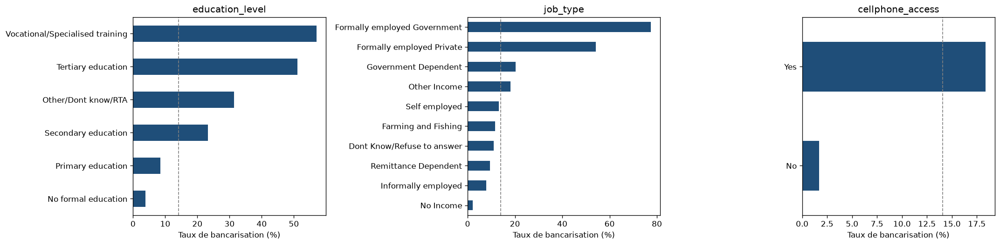
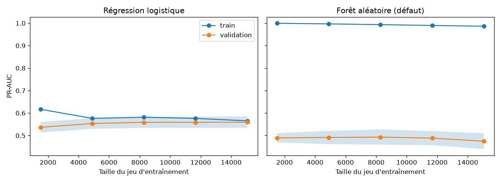
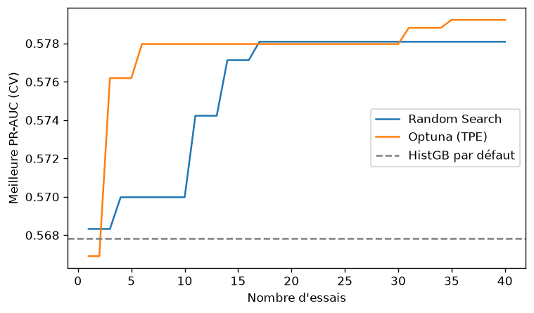
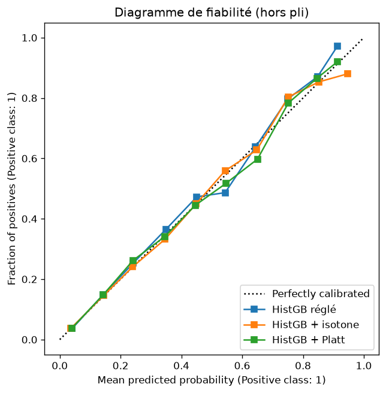
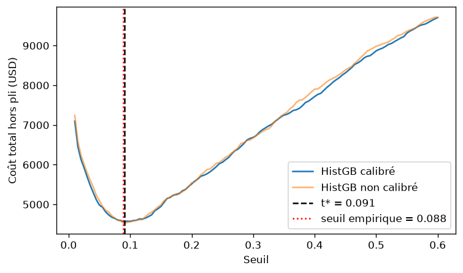
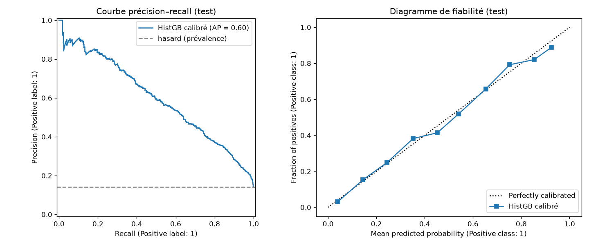
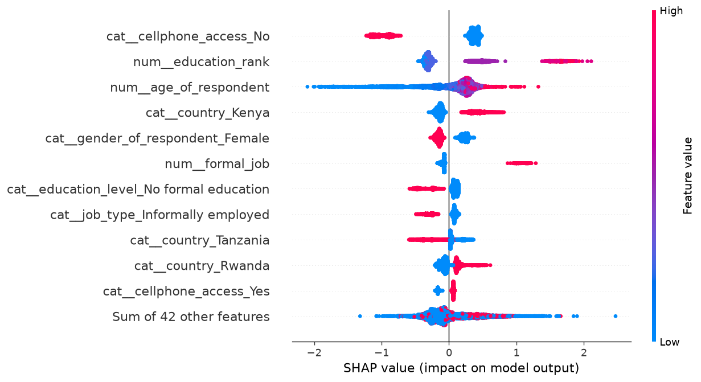
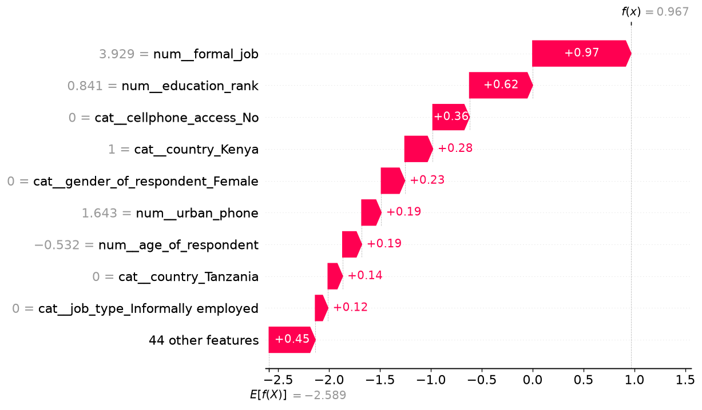

# Rapport final de notre travail: prédire qui possède un compte bancaire

Cas pratique Module 5 · AIMS Sénégal · Diabel KANDJI

## 1. On essaie de poser le problème

Le but est de prédire si une personne possède un compte bancaire, à partir des enquêtes FinScope faites au Kenya, au Rwanda, en Tanzanie et en Ouganda entre 2016 et 2018 (données Zindi, 23 524 personnes).

C'est une entreprise KaziPay qui veut contacter les gens qui ont déjà un compte. Si on contacte quelqu'un qui n'a pas de compte, on perd 0,5 USD. Si on oublie quelqu'un qui a un compte, on perd 5 USD. Une banque centrale veut aussi estimer combien de personnes ont un compte dans chaque pays.

Seulement 14 % des personnes ont un compte. Au début je pensais utiliser l'accuracy, mais j'ai vu qu'un modèle qui dit « non » à tout le monde a déjà 85,9 % d'accuracy alors qu'il ne trouve personne. J'ai donc choisi :

- la PR-AUC comme métrique principale (au hasard elle vaut 0,14, la prévalence) ;
- le Brier et l'ECE pour vérifier que les probabilités sont fiables (important pour la banque centrale) ;
- le coût en USD pour KaziPay.

Comme une erreur « oubli » coûte 10 fois plus qu'un contact inutile, le seuil de décision ne doit pas être 0,5 mais environ 0,5 / (0,5 + 5) = 0,09.

## 2. Ce que j'ai trouvé dans les données

- Pas de valeur manquante.
- Le taux de bancarisation change beaucoup selon le pays : 25 % au Kenya, moins de 12 % ailleurs.
- La colonne `year` ne sert à rien : chaque pays a une seule année. Je l'ai enlevée.
- `uniqueid` n'est pas vraiment unique (il recommence dans chaque pays) et ce n'est qu'un numéro. Je l'ai enlevé aussi.
- 484 profils identiques ont des réponses différentes (« Yes » et « No »). Donc aucun modèle ne peut être parfait : c'est le bruit irréductible du cours.
- Les variables qui semblent les plus liées au compte : l'éducation, le type d'emploi (surtout l'emploi formel) et avoir un téléphone (1,7 % de bancarisés sans téléphone contre 18 % avec).

*Figure 1 – Taux de bancarisation selon l'éducation, l'emploi et le téléphone*

## 3. Ma méthode

1. J'ai mis 20 % des données de côté comme test, sans y toucher jusqu'à la fin.
2. J'ai mis toutes les transformations (nouvelles variables, one-hot, standardisation) dans un pipeline scikit-learn pour éviter les fuites.
3. J'ai comparé les modèles avec une validation croisée stratifiée à 5 plis, toujours avec les mêmes plis et en donnant moyenne ± écart-type.
4. J'ai comparé plusieurs modèles, puis réglé les hyperparamètres du modèle choisi avec Random Search et Optuna.
5. J'ai vérifié la calibration des probabilités, puis choisi le seuil selon les coûts.
6. À la fin seulement, j'ai évalué une fois sur le test et j'ai interprété le modèle avec SHAP.

J'ai ajouté deux variables à moi (`is_alone` et `household_group`, liées à la taille du ménage). Honnêtement, elles n'ont rien amélioré (−0,0015 de PR-AUC, ce qui est dans le bruit).

## 4. Résultats en validation croisée

| Modèle | PR-AUC (moyenne ± écart-type) |
|---|---|
| Dummy (répond toujours « non ») | 0,141 ± 0,000 |
| Régression logistique | 0,559 ± 0,028 |
| Forêt aléatoire par défaut | 0,476 ± 0,040 |
| Forêt aléatoire (min_samples_leaf = 50) | 0,566 ± 0,032 |
| XGBoost | 0,544 ± 0,024 |
| LightGBM | 0,565 ± 0,028 |
| HistGradientBoosting | 0,568 ± 0,028 |
| CatBoost | 0,582 ± 0,027 |
| HistGradientBoosting réglé (Optuna) | 0,579 ± 0,026 |

Ce que j'en retiens :

- La forêt par défaut surapprend énormément (0,99 en train, 0,48 en validation). En augmentant `min_samples_leaf`, ça s'arrange.

*Figure 2 – Courbes d'apprentissage : régression logistique et forêt aléatoire*

- CatBoost est le meilleur sur chaque pli, mais l'écart est petit (environ 0,015) et il met environ 60 secondes à s'entraîner, contre 1 seconde pour HistGB. J'ai donc choisi HistGB pour la suite.
- Le réglage des hyperparamètres a apporté +0,011 environ, soit moins d'un demi écart-type. C'est un petit gain.
- Optuna a trouvé un bon score un peu plus vite que Random Search, mais avec une seule graine je ne peux pas dire qu'il est meilleur en général.

*Figure 3 – Meilleur score selon le nombre d'essais (Random Search et Optuna)*

## 5. Calibration et seuil

HistGB était déjà assez bien calibré (ECE de 0,008). J'ai quand même testé Platt et isotone : ça change très peu. J'ai gardé Platt.

*Figure 4 – Diagramme de fiabilité avant et après calibration*

Pour la banque centrale, j'ai été surpris : c'est la régression logistique qui donne les meilleurs totaux par pays (erreur moyenne 0,2 %), mieux que HistGB (2,5 %). La forêt aléatoire se trompe de 43 % en Ouganda.

Pour le seuil, sur les prédictions hors pli du train :

| Stratégie | Coût (USD) |
|---|---|
| Seuil 0,5 | 8 868 |
| Seuil théorique 0,09 | 4 551 |
| Contacter tout le monde | 8 084 |
| Ne contacter personne | 13 250 |

Le seuil trouvé automatiquement par `TunedThresholdClassifierCV` (0,088) est presque le même que le seuil théorique, ce qui confirme que les probabilités sont bien calibrées. J'ai gardé 0,09.

*Figure 5 – Coût total selon le seuil (prédictions hors pli)*

## 6. Résultat final sur le test

| | Test (4 705 personnes) |
|---|---|
| PR-AUC | 0,597 (IC 95 % : 0,560 à 0,634) |
| ROC-AUC | 0,875 |
| Recall | 0,88 |
| Précision | 0,31 |
| Coût au seuil 0,09 | 1 036 USD |
| Coût si on contacte tout le monde | 2 021 USD |

Le modèle retrouve 88 % des personnes bancarisées et coûte environ deux fois moins cher que de contacter tout le monde. Le score de validation croisée (0,577) est dans l'intervalle de confiance du test, donc mon estimation n'était pas trop optimiste.

*Figure 6 – Courbe précision–recall et diagramme de fiabilité sur le test*

## 7. Ce que le modèle a appris

Avec l'importance par permutation et SHAP, les variables les plus importantes sont : le niveau d'éducation, le type d'emploi, le pays, l'accès au téléphone et l'âge. Ça confirme mes trois hypothèses de l'exploration.

*Figure 7 – Contributions SHAP des variables (test)*

Exemple pour une personne (homme de 30 ans, Kenya, études secondaires, salarié du privé) : le modèle lui donne 74 % de chances d'avoir un compte, surtout à cause de son emploi formel et de son niveau d'éducation.

*Figure 8 – Explication SHAP de la prédiction pour une personne*

Attention : ce sont des corrélations. On ne peut pas dire que donner un téléphone à quelqu'un lui fera ouvrir un compte.

Sur le genre : il est utilisé par le modèle, et les femmes qui ont un compte sont un peu moins bien retrouvées (recall 0,85) que les hommes (0,91). À mon avis, il vaudrait mieux enlever cette variable pour décider qui contacter, et la garder seulement pour vérifier que le modèle est équitable.

## 8. Limites

- Les données viennent seulement de 4 pays d'Afrique de l'Est. Quand j'enlève un pays entier pendant l'entraînement, les résultats baissent. Pour utiliser le modèle au Sénégal, il faudrait des données sénégalaises.
- Les coûts (0,5 et 5 USD) sont inventés pour l'exercice.
- Je n'ai fait qu'un seul découpage et une seule graine.

## 9. Mes erreurs et ce que j'ai appris

Pendant le projet j'ai fait plusieurs erreurs que j'ai dû corriger :

- J'avais évalué des modèles sur le test dès l'étape 3. Je n'avais pas bien compris que regarder le test, même juste pour voir, le transforme en jeu de validation. J'ai tout refait avec le test mis de côté (je l'ai signalé dans le README).
- J'avais aussi fait une validation croisée sur toutes les données (train + test) au lieu du train seulement.
- Dans le notebook des hyperparamètres, j'utilisais une fonction avant de l'avoir définie, et le notebook plantait quand on l'exécutait de haut en bas.
- Pour CatBoost, j'avais passé une liste au lieu d'un tuple pour `cat_features`, ce qui empêchait d'utiliser `cross_validate` (le piège était pourtant signalé dans le guide).
- Mon calcul de la règle d'une erreur-type affichait une valeur différente de celle que je calculais.

Ce que je retiens surtout : un bon score ne veut rien dire si le protocole n'est pas propre, et il faut toujours regarder l'écart-type avant de dire qu'un modèle est meilleur qu'un autre. J'ai aussi compris que le choix du seuil compte autant que le modèle : au seuil 0,5, mon modèle coûtait plus cher que de contacter tout le monde.

## 10. Utilisation d'un assistant IA

Pour bien faire ce projet, je me suis fait aider par un assistant IA.

Les décisions importantes viennent de moi. C'est moi qui ai choisi le problème, les données et les coûts (0,5 et 5 USD), et qui ai décidé de la méthode : mesurer avec la PR-AUC et choisir le seuil selon les coûts. J'ai aussi écrit ou corrigé une partie du code moi-même. Par ailleurs, certains morceaux de code se trouvaient déjà dans le document de travail qui nous a été donné.

L'assistant m'a surtout aidé à écrire le code : les modules de `src/inclusion_financiere/`, les tests . Il m'a aussi aidé à rédiger et simplifier le README et ce rapport pour eviter les fautes. Les commits faits avec lui portent une mention `Co-Authored-By` dans l'historique Git.

Au total, j'estime avoir fait environ 80 % du travail.
